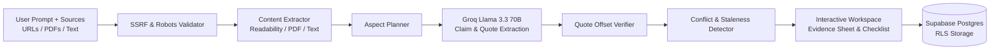

# Pramana (प्रमाण)
### *Know what's proven, and what isn't.*

**Pramana** is an AI-powered evidence verification engine designed for high-stakes research. Instead of generating generic summaries that gloss over missing facts or blend contradictory details together, Pramana maps what a complete answer requires, checks every claim quote-by-quote against your source documents, and surfaces **missing information (gaps)**, **conflicts**, and **outdated sources**.

[](https://nextjs.org/)
[](https://www.typescriptlang.org/)
[](https://supabase.com/)
[](https://groq.com/)
[](https://tailwindcss.com/)

---

## 🎯 The Problem

When applying for scholarships, verifying university admissions, auditing compliance policies, or reviewing legal guidelines:
- **LLMs hallucinate**: They confidently generate smooth prose without checking whether the underlying documents actually say so.
- **Silent omissions**: If a document doesn't mention renewal rules or income certificate validity dates, standard chat interfaces don't warn you that a critical requirement is missing.
- **Unnoticed conflicts**: When an official portal says "valid for 6 months" and a student advisory says "1 year", chat summaries often blend them into an erroneous compromise.

**Pramana solves this** by treating research as an evidence graph where every claim must be backed by an exact, verified quote from your sources.

---

## ✨ Key Features

- **Quote-by-Quote Grounding**: Extracts claims with character offset ranges in the original document. If a claim cannot be verified against the source text, it is rejected.
- **Coverage Score & Ring**: Computes an evidence coverage metric across all necessary aspects of your inquiry.
- **Missing Information (Gaps)**: Explicitly flags required aspects that none of the provided sources address.
- **Conflict Detection**: Pinpoints contradictory statements between sources and presents them side-by-side with source attribution.
- **Staleness Tracking**: Analyzes publication dates and academic/policy cycles to warn you when a source is outdated.
- **Interactive Evidence Sheet**: Click on any citation `[1]`, `[2]` to open the source document with the exact supporting quote highlighted in context.
- **Ranked Action Checklist**: Generates a prioritized, interactive to-do list showing what you need to verify before submitting an application or decision.
- **SSRF-Safe Ingestion**: Fetches public web URLs with strict DNS resolution checks (blocking private IPs, loopbacks, and cloud metadata endpoints) and respects `robots.txt`.
- **Offline / Sample Demo Mode**: Instant one-click replay of an evaluation scenario with zero API dependencies.

---

## 🏗️ Architecture & Tech Stack



- **Frontend**: Next.js 16 (App Router, Turbopack), React 19, Tailwind CSS v4, Lucide icons, Geist typography.
- **LLM Pipeline**: Groq SDK (`llama-3.3-70b-versatile`) with structured JSON schema streaming.
- **Search & Suggestions**: Tavily Search API with fallback domain heuristics.
- **Storage & Auth**: Supabase PostgreSQL with Row Level Security (RLS) policies and Google OAuth 2.0.
- **Parsers & Security**: Custom SSRF socket pinning, `robots.txt` matcher, Mozilla Readability, Turndown, PDF parser.

---

## 🚀 Quick Start

### 1. Clone the repository
```bash
git clone https://github.com/Adochaure/PRANAMA-AI.git
cd PRANAMA-AI/pramana
```

### 2. Install dependencies
```bash
npm install
```

### 3. Configure environment variables
Create a `.env.local` file in the `pramana` folder (see `.env.example`):
```env
# Supabase
NEXT_PUBLIC_SUPABASE_URL=https://your-project.supabase.co
NEXT_PUBLIC_SUPABASE_PUBLISHABLE_KEY=your-supabase-anon-key

# Live Analysis (Optional for local sample mode)
GROQ_API_KEY=gsk_...
TAVILY_API_KEY=tvly-...
```

### 4. Run the development server
```bash
npm run dev
```
Open [http://localhost:3000](http://localhost:3000) in your browser.

---

## 🧪 Testing & Verification

Pramana includes deterministic unit tests and fixtures for Stage 3 evaluation:

```bash
# Run deterministic test suite (SSRF, robots, PDF parsing, quote verification, score)
npm run test:stage3

# Run the mock pipeline check against planted evaluation fixtures
npm run sample:mock

# Build production bundle
npm run build
```

---

## 🎬 Live Demo Scenarios

### Option A: The One-Click Instant Demo
On the homepage or dashboard, click **"Try the sample scholarship"**:
- Ingests 4 contrasting sources (Official notice, 2023 archived notice, student advisory guide, directory aggregator).
- Discovers an unaddressed **Renewal condition gap**.
- Detects a direct **Income certificate validity conflict** between the official portal (6 months) and the advisory guide (1 year).
- Flags the 2023 document as **outdated**.
- Click **"Try adding the Renewal FAQ"** to watch the coverage score jump from 78% to 92% and close the gap in real-time.

### Option B: Real Web Link Check
Paste real, live URLs into the composer:
- **Question**: `What is the recommended maximum line length and indentation rule according to PEP 8?`
- **Source 1**: `https://peps.python.org/pep-0008/` (Official Python Enhancement Proposal)
- **Source 2**: `https://en.wikipedia.org/wiki/PEP_8` (Wikipedia summary)

---

## 🛡️ Security & Privacy

- **Safe Link Fetching**: Outbound HTTP/HTTPS requests resolve hostnames before connection; loopback (`127.0.0.1`), private RFC1918 subnets, link-local, and cloud metadata services (`169.254.169.254`) are strictly blocked.
- **Content Limits**: 8 sources per analysis, 2 MB max per fetch/upload, 30,000 characters per extracted document.
- **Row Level Security**: Users can only read and delete their own saved analyses and history.

---

## 👥 Hackathon Team

Built for the **Shinchan Online Hackathon 2026**.

- **Repository**: [github.com/Adochaure/PRANAMA-AI](https://github.com/Adochaure/PRANAMA-AI)
- **Live Deployment**: [pranama-ai.vercel.app](https://pranama-ai.vercel.app)
